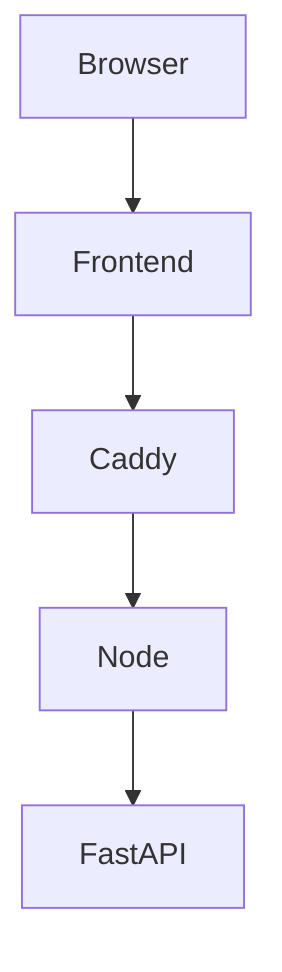

# web-compliance

## Description
A secured api/frontend for the AQL platform.
Features
- unit tests
- profile tests

---

## Endpoints
These endpoint can also be reached with 
```bash
curl -ikL localhost
```
while services are running.

### /api/manifest/list
Displays all possible test files.

### /api/manifest/{filename}
Runs all tests in the test file.

### /api/manifest/github/{filename}
Runs all tests in the test file. Render as html from md file.

### /api/manifest/html/{filename}
Runs all tests in the test file. Render as html.

### /api/manifest/markdown/{filename}
Runs all tests in the test file. Render as html from md file.

### /api/manifest/pdf/{filename}
Runs all tests in the test file. Render as html from pdf file

### /api/manifest/cache/{filename}
Runs all tests in the test file. Cache test results.

### /api/manifest/failfast/{filename}
Runs all tests in the test file. Stop testing if ANY error.

### /api/manifest/failfast/query/{filename}
Runs all tests in the test file. Stop testing if query fails.

### /api/manifest/profile/{filename}
Runs all tests in the test file. Order DESC by duration

### /api/manifest/retry/{times}/{filename}
Runs all tests in the test file. Retry failed tests.

### /api/suite/list
Displays all possible suite files.

### /api/suite/{filename}
Runs all tests in the test files.

### /api/suite/github/{filename}
Runs all tests in the test file. Render as html from md file.

### /api/suite/html/{filename}
Runs all tests in the test file. Render as html.

### /api/suite/markdown/{filename}
Runs all tests in the test file. Render as html from md file.

### /api/suite/pdf/{filename}
Runs all tests in the test file. Render as html from pdf file

### /api/suite/cache/{filename}
Runs all tests in the test file. Cache test results.

### /api/suite/failfast/{filename}
Runs all tests in the test file. Stop testing if ANY error.

### /api/suite/failfast/query/{filename}
Runs all tests in the test file. Stop testing if query fails.

### /api/suite/profile/{filename}
Runs all tests in the test file. Order DESC by duration

### /api/suite/retry/{times}/{filename}
Runs all tests in the test file. Retry failed tests.

### /api/tag/list
Displays all possible test tags.

### /api/tag/{tag}
Runs all tests across test files with test tag.

### /api/tag/github/{tag}
Runs all tests across test files with test tag. Render as html from md file.

### /api/tag/html/{tag}
Runs all tests across test files with test tag. Render as html.

### /api/tag/markdown/{tag}
Runs all tests across test files with test tag. Render as html from md file.

### /api/tag/pdf/{tag}
Runs all tests across test files with test tag. Render as html from pdf file

### /api/tag/cache/{tag}
Runs all tests across test files with test tag. Cache test results.

### /api/tag/failfast/{tag}
Runs all tests across test files with test tag. Stop testing if ANY error.

### /api/tag/failfast/query/{tag}
Runs all tests across test files with test tag. Stop testing if query fails.

### /api/tag/profile/{tag}
Runs all tests across test files with test tag. Order DESC by duration

### /api/tag/retry/{times}/{tag}
Runs all tests across test files with test tag. Retry failed tests.

---

## To run

### Start services
```bash
docker compose up --build
```

### View frontend
[localhost](https://localhost)

### Health check
```bash
curl -ikL localhost/health
```

### Call API
```bash
curl -ikL localhost/api/data
```

### Run playwrite tests
```bash
docker compose --profile test up
```

### Stop services
```bash
docker compose down
```

### Cleanup docker
```bash
docker volume prune && docker system prune
```
---

## Services

### Caddy
Reverse proxy with additional rate limit plugin. Manages self-signed ssl certificates.

### FastAPI
A python based api only gateway protected by docker secrets file. Being python based, can use `subprocess` function to make external calls to AQL platform applications.

### Frontend
A React simple page that displays api data.

### Node
A nodejs express BFF (backend for frontend) gateway protected by docker secrets file.

### Playwrite
Tests browser and api.

---

## Creating docker secrets
```bash
openssl rand -hex 32
```

---

## How docker secrets are shared
```text
             Docker secret
                  │
          ┌───────┴────────┐
          ▼                ▼
       Node.js           FastAPI
          │                │
          └── same key ────┘
```

---
## Network Flow

```text
                  PUBLIC
        ┌───────────┼───────────┐
        │           │           │
      Caddy      frontend     MinIO
        │                       │
        │                       │
        └───────────────────────┘

                  BACKEND
        ┌───────────┼───────────┐
        │           │           │
       Node      FastAPI       MinIO
```
---

## System Flow



## Reference
This is a web implementation of a [CLI tool](https://github.com/bearddaniel80-netizen/compliance-public.git).